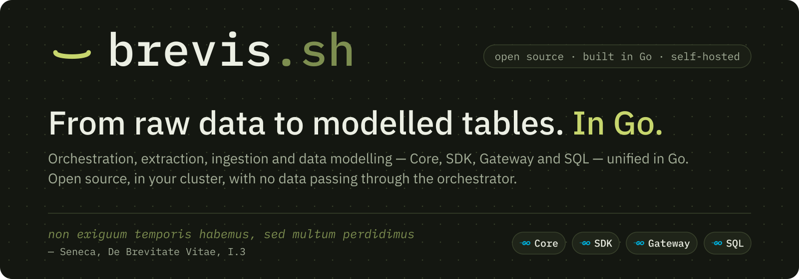
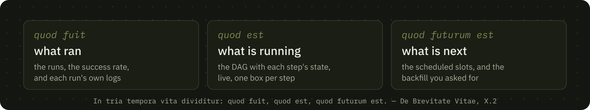

<!-- This file is the organisation's front page: github.com/brevis-sh renders
     it above the repositories. The images are SVGs with every glyph as a
     path (profile/assets/, generated by the script named in the root README),
     because GitHub shows README images inside  and through a proxy, where
     an SVG cannot load a web font. Each carries its own dark ground, so one
     file works in both GitHub themes. -->

<p align="center">
  <a href="https://brevis.sh"></a>
</p>

<h1 align="center">Open source data infrastructure, in Go.</h1>

<p align="center">
<b>brevis.sh</b> is a data orchestration runtime written in Go. One binary brings together what normally takes four tools — declarative transformation, workflow orchestration, a persistent queue, a scheduler and an interface to operate all of it — and every step runs as its own Kubernetes pod, with its own image. Around it, three pieces in the same language: an SDK that fetches, a Gateway that receives, and SQL that models where the data landed.
</p>

<p align="center">
  <a href="https://brevis.sh"><b>Website</b></a> ·
  <a href="https://brevis.sh/docs/"><b>Documentation</b></a> ·
  <a href="https://brevis.sh/docs/quickstart/">Quickstart</a> ·
  <a href="https://brevis.sh/docs/sdk/">Go SDK</a> ·
  <a href="https://brevis.sh/docs/python/">Python</a> ·
  <a href="https://github.com/brevis-sh/brevis/issues">Issues</a> ·
  <a href="https://brevis.sh/llms.txt">llms.txt</a>
</p>

<p align="center">
  <a href="https://github.com/brevis-sh/brevis/releases"></a>
  <a href="https://github.com/brevis-sh/brevis/releases"></a>
  <a href="https://github.com/brevis-sh/brevis/releases"></a>
  <a href="https://github.com/brevis-sh/brevis/releases"></a>
  <a href="https://pypi.org/project/brevis/"></a>
  <br>
  <a href="https://github.com/brevis-sh/brevis/actions/workflows/test.yml"></a>
  <a href="https://hub.docker.com/r/areteacademy/brevis"></a>
  <a href="https://github.com/brevis-sh/brevis/blob/master/LICENSE"></a>
  <a href="https://github.com/brevis-sh/brevis/stargazers"></a>
</p>

<br>

A workflow is one file. Each step declares its own image, and the engine runs each one as its own pod:

```yaml
name: daily_ingest
schedule: "0 5 * * *"     # five-field cron
type: dag

steps:
  - id: extract
    image: ghcr.io/example/extract:1.4        # 5.8 MB, a Go step
    run: ./extract --since yesterday

  - id: transform
    image: ghcr.io/dbt-labs/dbt-postgres:1.9  # 620 MB, dbt
    run: dbt build --select bronze+
    depends_on: [extract]
```

```bash
brevis validate examples/            # validates with no database; good for CI
brevis run examples/hello.yaml       # runs now, on this instance
brevis serve                         # the API and the console, on :8080
brevis scheduler --concurrency 5     # materialises slots and runs them
```

## Why *brevis*

> **Non exiguum temporis habemus, sed multum perdidimus.**<br>
> *It is not that we have little time, but that we lose much of it.*<br>
> — Seneca, *De Brevitate Vitae*, I.3

*brevis* is Latin for *short*. The name comes from Seneca's essay on the shortness of life, and the mark is the **breve** — the sign a Roman grammarian wrote over a short syllable: *brĕvis*. Its counterpart, the macron, marks the long one, and would be wrong for this word.

Seneca's argument is not that life is short. It is that we hand it away, a piece at a time, to things that were never ours to do. A data team knows the feeling. The time was never short; the stack spent it: four tools with four versioning schemes and four places to look when something fails, a worker image that carries everyone's dependencies, a second service to install and keep alive, and the failure that shows up in the cluster at five in the morning instead of in the pull request.

So the question behind every design decision in brevis.sh is one Seneca would recognise: **which complexities truly deserve a team's time?** Four of his lines, and what each one decided in the code:

| Seneca wrote | so the code does |
|---|---|
| **Non accipimus brevem vitam sed fecimus.** *We are not given a short life; we make it so.* — I.4 | **One binary.** `serve`, `scheduler`, `migrate`, `run` and `validate` are subcommands of the same artefact: the API, the queue, the scheduler and the console, with no second service to install and keep alive. Migrations, fonts and bundles are compiled in, so it works with no route to the internet. |
| **Nemo aestimat tempus.** *No one puts a price on time.* — VIII.2 | **One pod per step, with its own image.** There is no generic worker: the work brings its own runtime. A Go fetcher costs 5.8 MB and 0.18 s to start, and no longer pays for the 620 MB dbt beside it. |
| **Vita, si uti scias, longa est.** *Life, if you know how to use it, is long.* — II.1 | **Validation needs no database.** `brevis validate` runs in CI next to the tests, so a wrong YAML fails in the pull request and not in the cluster. The scheduler creates runs and the queue executes them, as two independent loops: either can go down without taking the other with it. |
| **In tria tempora vita dividitur: quod fuit, quod est, quod futurum est.** *Life is divided into three times: what was, what is, what will be.* — X.2 | **The overview is drawn in those three tenses.** What ran, what is running and what is next, on one screen, in the same binary. |

<p align="center">
  <a href="https://brevis.sh/#console"></a>
</p>

Seneca keeps the verb *to live* for one kind of person: *soli omnium otiosi sunt qui sapientiae vacant, soli vivunt* — of all people, only those who make time for wisdom are at leisure; only they live (XIV.1). The time the glue no longer takes goes back to the domain only your team knows. That is the whole point of the name.

## Go, for data teams

Data infrastructure grew up on the JVM and in Python, and every team pays for that in the same currency: start-up time, image size, memory ceilings, and one more runtime to install, patch and keep alive. brevis.sh brings the way Go builds things to that problem.

- **One static binary, and nothing to install beside it.** The console, its fonts, the migrations and the metrics endpoint ship inside the binary, built for amd64 and arm64. A cluster with no route out runs the same thing your laptop does.
- **Pods that start before you notice.** The images are per role, not per project, and the numbers are measured: **5.8 MB and 0.18 s** for a Go step, 118 MB for Python, 620 MB for dbt. Before that, one 1.87 GB image for everything, and a Go fetcher inheriting the memory ceiling of the largest thing next to it. [`docs/IMAGES.md`](https://github.com/brevis-sh/brevis/blob/master/docs/IMAGES.md)
- **Streams, not frames.** The SDK hands rows over as `iter.Seq2`, extracts over HTTP with retry, timeout, guard and pagination, and loads in batches into BigQuery, Postgres, MySQL, Redshift and files. What you import is what you compile: a whole file pipeline costs 195 packages and no cloud SDK at all. [Go SDK](https://brevis.sh/docs/sdk/)
- **Throughput with three witnesses.** The Gateway accepted **5,431,000 events at 135,768/s** with a p99 of 22.7 ms, and the benchmark only passes when k6, the gateway's own counters and the rows in Postgres agree. A run where they disagree failed, whatever the percentiles say. [Benchmarks](https://brevis.sh/docs/benchmarks/)
- **You do not have to write Go.** A step is an image: dbt, a Python script, a shell command. `pip install brevis` gives a Python step context, the run's window and its own metrics, with no dependencies at all. Go is what the runtime is made of, not what it asks of you. [Python](https://brevis.sh/docs/python/)

And when you do write Go, a pipeline is three calls — extract, transform, load — and the driver is a value, not a setting:

```go
rows, err := sdk.Extract(ctx, sdk.Source{From: from.HTTP{URL: url, Records: records}})
rows = sdk.Transform(rows, sdk.Accept("time", "temperature_2m", "latitude", "longitude"))
res, err := sdk.Load(ctx, rows, sdk.Target{
	To:      bigquery.Table{Dataset: "bronze", Name: "hourly_temperatures"},
	Columns: []string{"time", "temperature_2m", "latitude", "longitude"},
})
```

## The four pieces

<p align="center">
  <a href="https://brevis.sh/docs/ecosystem/"></a>
</p>

The **control plane** is the Core: it decides when each step runs, keeps the queue and the state in Postgres, and starts one pod per step. The data never goes through it. The **data plane** is the other three. Each is its own Go module, version and image, and the Core is a prerequisite for none of them.

<!-- The Go import path and the image namespace are the ones that resolve
     today. The modules move to brevis.sh/... and the images gain a brevissh/*
     namespace in the repository's own plan; update the three cells below on
     the day each lands. -->

| piece | what it does | how you get it | guide |
|---|---|---|---|
| **Core** | Schedules, queues and starts one pod per step. Never touches the data. | `brevissh/brevis` on Docker Hub, or `make build` | [Core](https://brevis.sh/docs/core/) |
| **SDK** | A Go library that extracts, shapes and loads, inside your step. | `go get github.com/brevissh/brevis/sdk@latest` | [Go SDK](https://brevis.sh/docs/sdk/) |
| **Gateway** | Takes HTTP POST, answers 202 and writes in batches. No database of its own. | `brevissh/brevis-gateway` | [Ingestion](https://brevis.sh/docs/ingestion/) |
| **SQL** | Plain `.sql` files become tables and views, in dependency order. | `brevissh/brevis-sql` | [SQL](https://brevis.sh/docs/sql/) |

Around them: the [console](https://brevis.sh/docs/console/), served by the Core; the [agent](https://brevis.sh/docs/pod-per-step/), which runs a step on a runtime you already keep — where the licence, the GPU or the allow-listed IP lives; and [`brevis` for Python](https://brevis.sh/docs/python/).

## The console

Six screens, server-rendered by the same binary, with no second service to install. White label from a YAML: title, phrase and palette, with a dark theme and a light one; the colours override the CSS variables at runtime, so changing the theme recompiles nothing.

<p align="center">
  <a href="https://brevis.sh/#console"></a>
  <a href="https://brevis.sh/#console"></a>
</p>

<p align="center"><sub>The overview, and one workflow. The screens are recreated in SVG with sample data, never screenshots: the real console operates customer data in production. Four more at <a href="https://brevis.sh/#console">brevis.sh</a>.</sub></p>

## Get started

Self-hosted, three ways, and the same binary in all three: Docker Compose on one machine, the Helm chart in your cluster, or an agent on a runtime you already keep. No service of ours in between.

```bash
git clone https://github.com/brevis-sh/brevis.git && cd brevis
make up        # Postgres, the API and the scheduler; the console at :8080
make smoke     # checks /health and /ready
```

```bash
helm install brevis ./deployments/helm/brevis --namespace data --create-namespace \
  --set database.url="postgres://brevis:pw@postgres/brevis?sslmode=require" \
  --set auth.user=admin --set auth.passwordHash="$(brevis hash)" \
  --set auth.secret="$(openssl rand -base64 48)"
```

The chart runs the migrations as a hook, and refuses to render a configuration that Kubernetes would accept and that would be wrong at runtime — starting with a second scheduler replica, which would materialise duplicate runs in silence.

| | |
|---|---|
| **Start here** | [Quickstart](https://brevis.sh/docs/quickstart/) — from nothing to a live DAG in the console, in four steps · [Installation](https://brevis.sh/docs/installation/) |
| **Reference** | [CLI](https://brevis.sh/docs/cli/) · [Workflow YAML](https://brevis.sh/docs/workflows/) · [Parameters](https://brevis.sh/docs/parameters/) · [Configuration](https://brevis.sh/docs/configuration/) |
| **Run it** | [Kubernetes](https://brevis.sh/docs/kubernetes/) · [Observability](https://brevis.sh/docs/observability/) · [White label](https://brevis.sh/docs/white-label/) |
| **Write a step** | [Go SDK](https://brevis.sh/docs/sdk/) · [Python](https://brevis.sh/docs/python/) · [Context between steps](https://brevis.sh/docs/context/) |
| **Land and model data** | [Ingestion](https://brevis.sh/docs/ingestion/) · [Sinks](https://brevis.sh/docs/ingestion-sinks/) · [SQL](https://brevis.sh/docs/sql/) |
| **For agents** | [llms.txt](https://brevis.sh/llms.txt) — the documentation as Markdown |

## In production

[Zarv](https://www.zarv.com) · [Promaqui](https://promaqui.com.br) · [Agiliza AI Leilões](https://www.agilizaaileiloes.com.br) · [Pulsar Code](https://pulsarcode.com.br) · [Encantos Amazônicos](https://encantosamazonicos.com.br)

Running brevis.sh and want to be listed? [Open an issue](https://github.com/brevis-sh/brevis/issues/new/choose).

## Take part

- **[brevis-sh/brevis](https://github.com/brevis-sh/brevis)** is the one repository: the engine, the SDK, the Gateway, SQL and the Python package, each with its own version and its own tag. Star it to follow the releases.
- **A bug or an idea** goes in an [issue](https://github.com/brevis-sh/brevis/issues/new/choose). The labels [`good first issue`](https://github.com/brevis-sh/brevis/labels/good%20first%20issue) and [`help wanted`](https://github.com/brevis-sh/brevis/labels/help%20wanted) mark where a first contribution fits.
- **[Contributing](https://github.com/brevis-sh/brevis/blob/master/CONTRIBUTING.md)** — the project speaks English, in code and in prose, and the CI holds the line. The two changelogs, [SDK](https://github.com/brevis-sh/brevis/blob/master/CHANGELOG.md) and [engine](https://github.com/brevis-sh/brevis/blob/master/CHANGELOG-motor.md), record what was decided and when.

<br>

<p align="center">
  <sub>brevis.sh was born at <a href="https://areteacademy.com.br">Aretê Academy</a> and is released under the MIT licence.<br>
  On 2026-11-01 the repository moved here from <code>AreteAcademy/brevis</code>; the old URLs, clones and <code>go get</code> paths redirect.</sub>
</p>
